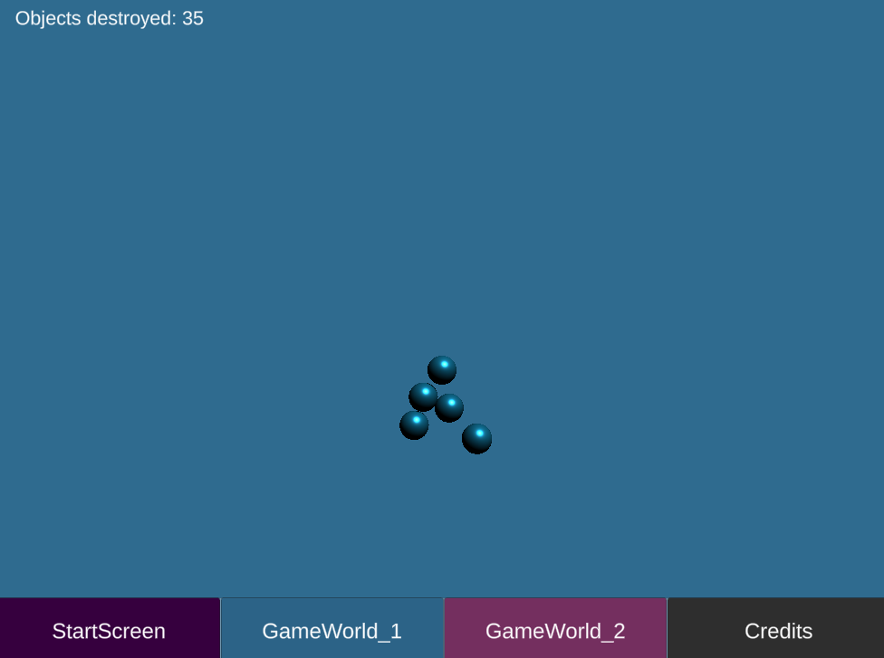
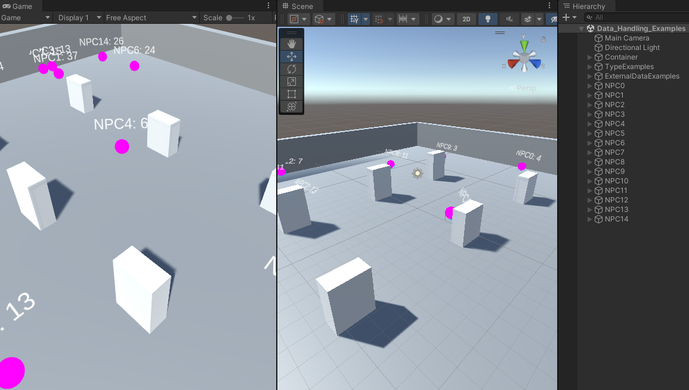
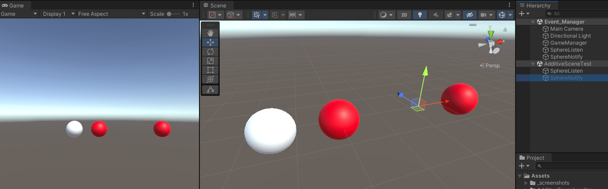
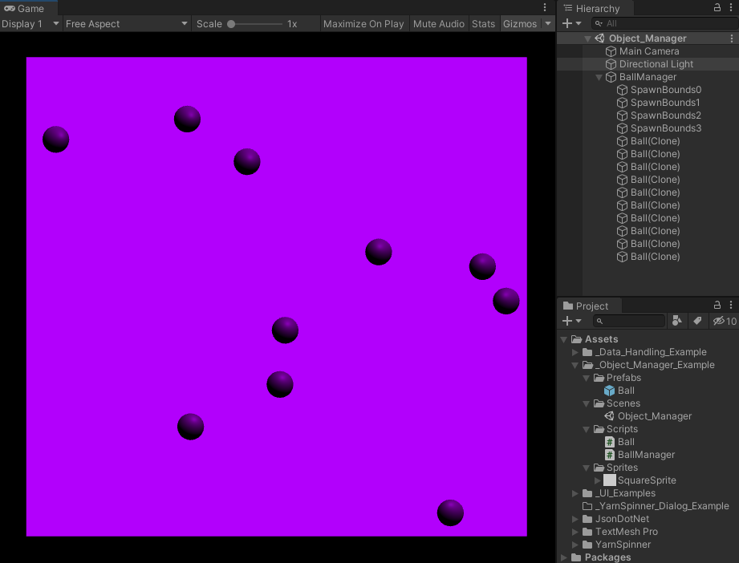
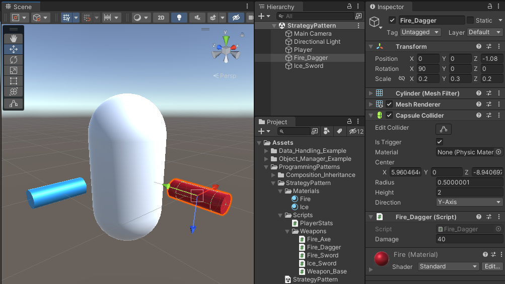
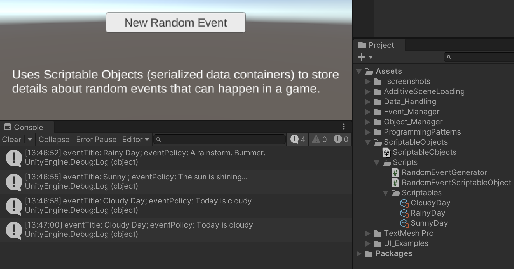
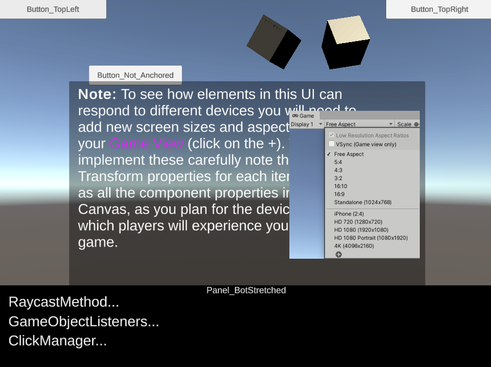

# dig250-unity-data

A sample Unity project with:

## AdditiveSceneLoading

- Keep "global" scenes (game manager, UI) open while swapping "world" scenes in and out
- Press Play in any scene and the rest of the game loads automatically
- See the comments in [LoadSceneManager.cs](Assets/AdditiveSceneLoading/Scripts/LoadSceneManager.cs) and [AdditiveSceneManager.cs](Assets/AdditiveSceneLoading/Scripts/AdditiveSceneManager.cs)

## Data_Handling 

- Working with different C# data types (struct, class, dictionary, etc.)
- Working with external data (e.g. JSON)

## Event_Manager

- Example with additive scene loading  
- Notify other game objects across additive scenes about events using [EventManager](https://learn.unity.com/tutorial/create-a-simple-messaging-system-with-events#)

## Object_Manager 

- Spawning new objects using Collider2D bounds
- Moving objects from an origin to a target
- Coroutine to Instantiate new objects

## ProgrammingPatterns/StrategyPattern

- Implementation of composition over inheritance using C# interfaces

## ScriptableObjects

- Uses Scriptable Objects (serialized data containers) to store details about random events that can happen in a game.
- See [Unity Manual: ScriptableObject](https://docs.unity3d.com/Manual/class-ScriptableObject.html) or [this reference sheet](https://github.com/omundy/dig250-game-art-dev/blob/main/reference-sheets/Unity-Scripting-Collections.md) for details

## UI Examples

- Different ways to add UI elements (anchor vs. pixel)
- How to use ray tracing to detect clicks on objects in 3D space
- Clicking, text changes, and data exchange between UI elements

